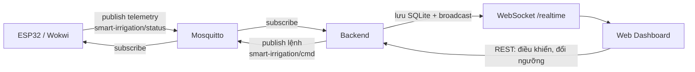

# Smart Irrigation Backend

Backend trung gian giữa Web Dashboard, Mosquitto (MQTT) và ESP32/Wokwi.
Stack: **Node.js + TypeScript + Express 5 + better-sqlite3 + WebSocket**.

## Luồng dữ liệu



- Thiết bị gửi telemetry khoảng 2 giây/lần; backend chỉ ghi lịch sử 10 giây/lần để nhẹ DB.
- Mọi telemetry hợp lệ được push ngay cho Web qua WebSocket, không cần polling.

## Yêu cầu môi trường

- **Node.js 18+** và npm.
- **MQTT broker** (Mosquitto) đang chạy — mặc định `mqtt://127.0.0.1:1883`.
  - Windows: cài Mosquitto và chạy service, hoặc chạy `mosquitto -v` ở terminal riêng.
- Cổng mặc định: backend `3001`.

## Chạy local

```powershell
npm install
Copy-Item .env.example .env
npm run dev
```

Kiểm tra nhanh sau khi chạy:

```powershell
curl http://localhost:3001/api/health
```

Kết quả `ok: true` nghĩa là cả database và MQTT đều sẵn sàng.

## Biến môi trường (`.env`)

| Biến | Mặc định | Ý nghĩa |
|---|---|---|
| `PORT` | `3001` | Cổng HTTP/WebSocket của backend. |
| `MQTT_URL` | `mqtt://127.0.0.1:1883` | Địa chỉ MQTT broker. |
| `MQTT_STATUS_TOPIC` | `smart-irrigation/status` | Topic nhận telemetry từ thiết bị. |
| `MQTT_COMMAND_TOPIC` | `smart-irrigation/cmd` | Topic gửi lệnh xuống thiết bị. |
| `WEB_ORIGIN` | `http://localhost:3000` | Origin được phép gọi API (CORS). |
| `DEFAULT_DEVICE_ID` | `esp32-garden-01` | Device ID mặc định của hệ thống. |
| `DB_PATH` | `data/smart-irrigation.db` | Đường dẫn file SQLite. |
| `DB_RETENTION_DAYS` | `30` | Số ngày giữ lịch sử trước khi tự dọn. |

## Cấu trúc mã nguồn (`src/`)

| File | Công dụng |
|---|---|
| `server.ts` | Điểm khởi chạy: Express app, middleware, `/api/health`, mount REST router, khởi động realtime, dọn dữ liệu cũ định kỳ, graceful shutdown. |
| `routes.ts` | Toàn bộ REST API: cấu hình khu vực, telemetry, lịch sử lệnh; validate input và publish lệnh MQTT. |
| `live.ts` | Realtime: WebSocket `/realtime`, cache telemetry mới nhất, watchdog online/offline, xác nhận/timeout lệnh, tự resync ngưỡng khi thiết bị lệch cấu hình. |
| `config.ts` | Đọc và kiểm tra biến môi trường (port, MQTT URL, topic, đường dẫn DB, retention). |
| `db.ts` | Mở SQLite (`better-sqlite3`) với WAL + `busy_timeout`, tạo schema/index, migration tự động. |
| `domain.ts` | Định nghĩa type dùng chung, kiểm tra hợp lệ telemetry (6 khu `T001`–`T006`), sinh chuỗi lệnh MQTT. |
| `garden-config.ts` | Cấu hình mặc định 6 khu vực (tên cây, phương pháp tưới, ngưỡng, lưu lượng) — chỉ dùng để seed, DB là nguồn cấu hình thật. |
| `mqtt-gateway.ts` | Kết nối Mosquitto: subscribe topic status, publish lệnh điều khiển, broadcast dữ liệu cho các listener. |
| `telemetry-repository.ts` | Lưu/truy vấn telemetry (transaction 1 sample + 6 zone), gộp mẫu theo bucket cho chart, log lệnh, dọn dữ liệu theo retention. |
| `zone-settings-repository.ts` | Đọc/ghi ngưỡng tưới từng khu vực, derive ngưỡng dừng (`threshold + 20`), ghi lịch sử thay đổi. |

## REST API

| Method | Endpoint | Mô tả |
|---|---|---|
| GET | `/api/health` | Trạng thái server: `mqtt`, `database`, số thiết bị online, số client realtime. |
| GET | `/api/config` | Cấu hình hệ thống + ngưỡng 6 khu (lấy từ DB). |
| GET | `/api/devices/:deviceId/config` | Cấu hình theo thiết bị. |
| GET | `/api/devices/:deviceId/config/changes?limit=` | Lịch sử thay đổi ngưỡng. |
| PUT | `/api/devices/:deviceId/config/zones/:zoneId` | Lưu ngưỡng tưới mới (body `{ "threshold": 55 }`). |
| GET | `/api/devices/:deviceId/telemetry/latest` | Snapshot telemetry mới nhất (404 nếu chưa có). |
| GET | `/api/devices/:deviceId/telemetry/history?from=&to=&zoneId=&limit=&bucketMs=` | Lịch sử telemetry; `bucketMs` gộp mẫu (mặc định `(to-from)/500`) để chart nhẹ hơn. |
| GET | `/api/devices/:deviceId/commands?limit=` | Nhật ký lệnh (mặc định 50, tối đa 500). |
| POST | `/api/devices/:deviceId/commands` | Gửi lệnh điều khiển (xem bên dưới). |
| WS | `/realtime` | Push telemetry và trạng thái thiết bị theo thời gian thực. |

### Ví dụ gọi API

Đổi ngưỡng khu T001 về 55%:

```powershell
curl -X PUT http://localhost:3001/api/devices/esp32-garden-01/config/zones/T001 `
  -H "Content-Type: application/json" -d '{"threshold":55}'
```

Bật bơm khu T002 (chế độ thủ công):

```powershell
curl -X POST http://localhost:3001/api/devices/esp32-garden-01/commands `
  -H "Content-Type: application/json" -d '{"action":"PUMP_ON","zoneId":"T002"}'
```

Xem lịch sử 24h của khu T001:

```powershell
curl "http://localhost:3001/api/devices/esp32-garden-01/telemetry/history?zoneId=T001"
```

### Các lệnh hỗ trợ

| Body gửi lên | Lệnh MQTT sinh ra |
|---|---|
| `{"action":"SET_THRESHOLD","zoneId":"T001","value":55}` | `SET_THRESHOLD_T001_55` (tự clamp 10–90) |
| `{"action":"PUMP_ON","zoneId":"T002"}` | `PUMP_ON_T002` |
| `{"action":"PUMP_OFF","zoneId":"T002"}` | `PUMP_OFF_T002` |
| `{"action":"MODE_AUTO"}` | `MODE_AUTO` |
| `{"action":"MODE_MANUAL"}` | `MODE_MANUAL` |
| `{"action":"WEATHER_GATE_ON"}` / `OFF` | `WEATHER_GATE_ON` / `OFF` |
| `{"action":"PUMP_ON"}` (không zone) | `PUMP_ON` — chỉ khi đang ở chế độ manual, nếu không trả `409`. |

Lệnh gửi thành công trả `202` kèm `commandId`; trạng thái chuyển `confirmed` khi telemetry tiếp theo cho thấy lệnh đã có hiệu lực, hoặc `timeout` nếu thiết bị không phản hồi.

## Định dạng telemetry (MQTT)

Thiết bị publish JSON lên `smart-irrigation/status`; backend validate nghiêm ngặt:

```json
{
  "deviceId": "esp32-garden-01",
  "mode": "auto",
  "temperature": 28.5,
  "humidity": 62,
  "rain": 12,
  "raining": false,
  "weatherGate": true,
  "pump": false,
  "zones": [
    { "id": "T001", "moisture": 48, "threshold": 55, "stopThreshold": 75, "pump": false },
    { "id": "T002", "moisture": 51, "threshold": 55, "stopThreshold": 75, "pump": false }
  ]
}
```

- Phải đủ **cả 6 khu** `T001`–`T006`, không trùng, không thừa.
- `temperature`/`humidity` được phép `null` khi DHT22 đọc lỗi (không bị biến thành 0).
- `moisture`, `threshold`, `stopThreshold` nằm trong 0–100; `rain` trong 0–100.

## WebSocket `/realtime`

Server push các message dạng JSON:

| `type` | Nội dung |
|---|---|
| `telemetry` | `{ type, data: <telemetry>, online }` — mỗi telemetry mới. |
| `device-status` | `{ type, deviceId, online }` — khi thiết bị online/offline. |
| `command-result` | `{ type, commandId, deviceId, status }` — lệnh được xác nhận. |

Client mới kết nối sẽ nhận ngay snapshot telemetry + trạng thái của tất cả thiết bị. Server ping mỗi 30 giây và tự ngắt client không phản hồi.

## Database

Dùng SQLite qua `better-sqlite3`, file mặc định `data/smart-irrigation.db`
(cấu hình bằng `DB_PATH`). Database tự tạo bảng khi khởi động.

Cấu hình hiệu năng:

- `journal_mode = WAL` — đọc/ghi song song, bền hơn khi ghi liên tục.
- `busy_timeout = 5000` — chờ tối đa 5 giây thay vì lỗi ngay khi tiến trình khác giữ khóa DB.
- Index theo `(device_id, recorded_at)`, `(device_id, zone_id, recorded_at)` cho truy vấn lịch sử, và index `sample_id` cho JOIN/cascade xóa.

Các bảng:

| Bảng | Nội dung |
|---|---|
| `latest_telemetry` | Snapshot mới nhất mỗi thiết bị, khôi phục lại sau restart. |
| `telemetry_samples` | Mỗi mẫu lịch sử: nhiệt độ, độ ẩm, mưa, bơm, mode... |
| `telemetry_zone_samples` | Trạng thái 6 khu của từng mẫu (khóa ngoại tới `telemetry_samples`, xóa cascade). |
| `command_log` | Lệnh đã gửi và trạng thái `pending/confirmed/timeout/failed`. |
| `zone_settings` | Ngưỡng tưới đã lưu — nguồn cấu hình thật, ưu tiên hơn `garden-config.ts`. |
| `zone_setting_changes` | Lịch sử đổi ngưỡng (giá trị cũ → mới, thời gian). |

Dữ liệu cũ hơn `DB_RETENTION_DAYS` (mặc định 30 ngày) được dọn tự động mỗi ngày
— gồm `telemetry_samples` (cascade xóa zone samples), `command_log` và
`zone_setting_changes`.

## Ngưỡng tưới bền vững

- Khi đổi ngưỡng từ Web (`SET_THRESHOLD`), backend lưu ngay vào SQLite.
- `GET /api/config` trả ngưỡng từ DB, nên restart backend không mất cấu hình.
- Khi telemetry báo ngưỡng khác DB (ví dụ ESP32 vừa reboot), backend tự gửi lại
  `SET_THRESHOLD` (cooldown 10 giây/zone).
- Firmware cũng lưu ngưỡng vào NVS (`Preferences`) nên tự nhớ sau khi reboot.

## Lỗi thường gặp

| Hiện tượng | Nguyên nhân / cách xử lý |
|---|---|
| `/api/health` trả `503`, `mqtt: false` | Mosquitto chưa chạy hoặc sai `MQTT_URL`. Bật broker rồi thử lại. |
| Web báo không kết nối realtime | Sai `NEXT_PUBLIC_BACKEND_URL` ở Web, hoặc backend chưa chạy cổng 3001. |
| `409 Global pump control requires manual mode` | Lệnh bật/tắt bơm toàn vườn chỉ hợp lệ khi thiết bị ở chế độ `manual`. |
| `400 Telemetry must include every zone` | Firmware gửi thiếu khu — phải đủ `T001`–`T006`. |
| `SQLITE_BUSY` | Có tiến trình khác đang giữ DB; backend đã chờ 5 giây, kiểm tra tiến trình đang mở file DB. |
| Telemetry không vào history | Xem log backend: retained message không được ghi history, và tần suất ghi tối thiểu 10 giây/lần. |
