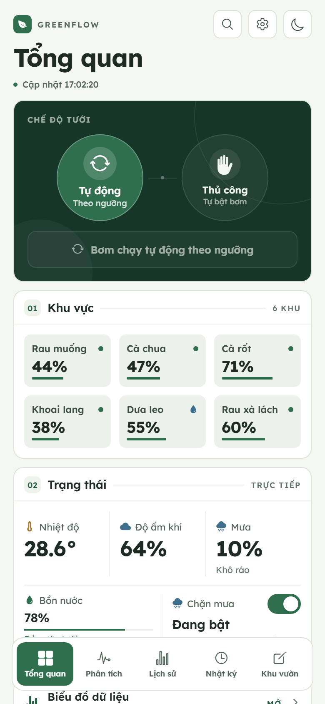
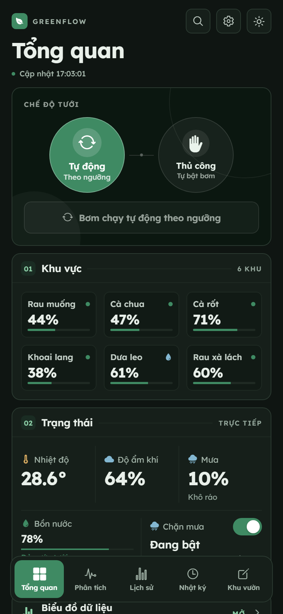

# Mobile App — Smart Irrigation System

Ứng dụng Expo/React Native để giám sát và điều khiển hệ thống tưới khi đang ở ngoài vườn. Dùng chung Backend, cấu hình và telemetry với Web Dashboard.

<div align="center">


</div>

## Chức năng

- **Tổng quan**: trạng thái online, nhiệt độ/độ ẩm/mưa, mực nước bồn, lưới 6 khu `T001`–`T006`; chuyển Tự động/Thủ công, bật tắt bơm; chạm một khu để xem chi tiết; kéo lên để mở biểu đồ.
- **Phân tích**: kết luận sức khoẻ khu đang chọn, % thời gian đất nằm trong ngưỡng, trung bình/nhỏ nhất/lớn nhất, gợi ý xử lý.
- **Lịch sử**: biểu đồ độ ẩm đất, nhiệt độ, độ ẩm khí, mưa theo 1 giờ / 24 giờ / 7 ngày.
- **Nhật ký**: lệnh đã gửi, đổi ngưỡng, trạng thái xác nhận; lọc theo loại và thời gian.
- **Khu vườn**: hai mục Cây trồng / Tưới — hồ sơ cây, ảnh, ngày trồng, loại đất; chỉnh ngưỡng, lưu lượng và mục tiêu nước.
- **Cài đặt** (mở từ bánh răng): theme theo máy / sáng / tối, chặn tưới khi mưa, thông tin thiết bị, bật và gửi thử thông báo.

## Công nghệ

Expo SDK 58 · React Native 0.88 · React 19 · Expo Router · TypeScript · Reanimated + Gesture Handler · react-native-svg · AsyncStorage · Expo Notifications · Expo Image Picker · Lexend · Ionicons.

## Cấu trúc `src/`

```text
src/
├─ app/          # 6 màn hình theo expo-router (index, analysis, history, activity, garden, settings)
├─ api/          # client HTTP, config, telemetry, commands, garden, activity, notifications
├─ providers/    # Garden (realtime + lệnh), Theme, Toast, Notifications
├─ hooks/        # useHistory, useActivity
├─ components/   # layout, navigation, overview, zones, garden, history, settings, ui
├─ theme/        # palette dùng chung với Web, spacing, typography
├─ utils/        # phân tích độ ẩm, nhóm cây, định dạng, haptics
└─ lib/          # quyền thông báo, Expo push token
```

`GardenProvider` mở một WebSocket duy nhất cho cả app, tự reconnect (tối đa 15 giây), giữ trạng thái lệnh đang chờ và ẩn số đo khi thiết bị offline.

## Chạy ứng dụng

```powershell
cd Code\Frontend\Mobile
Copy-Item .env.example .env
npm install
npm start
```

`.env`:

```dotenv
EXPO_PUBLIC_API_URL=http://192.168.1.10:3001
```

- Dùng IPv4 LAN của máy chạy Backend, không dùng `localhost` khi chạy trên điện thoại thật; mở firewall cổng 3001.
- Expo Go: quét QR. Nếu bỏ trống `EXPO_PUBLIC_API_URL`, app tự lấy IP từ Metro.
- Dev build/APK: `npm run android` hoặc build bằng EAS; giá trị `EXPO_PUBLIC_API_URL` được nhúng lúc build.

## Thông báo đẩy

- App đăng ký Expo push token với Backend theo `deviceId`; Android dùng kênh `alerts` ưu tiên cao.
- Nút "Gửi thử" gửi qua Backend → Expo nếu đã có máy đăng ký, ngược lại gửi thông báo cục bộ.
- Expo Go trên Android không lấy được token từ xa; muốn nhận push thật cần dev build/APK.

> Tài liệu đầy đủ về cả Web và Mobile: [Code/Frontend/README.md](../README.md).
