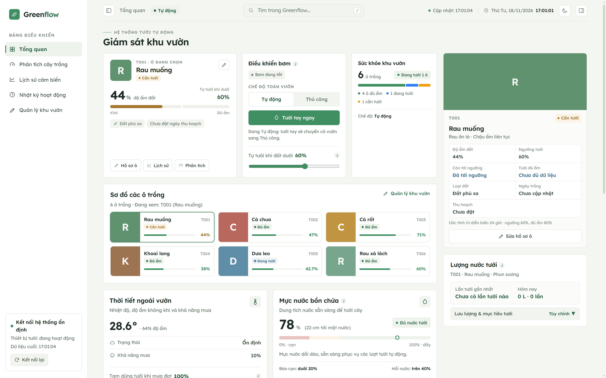
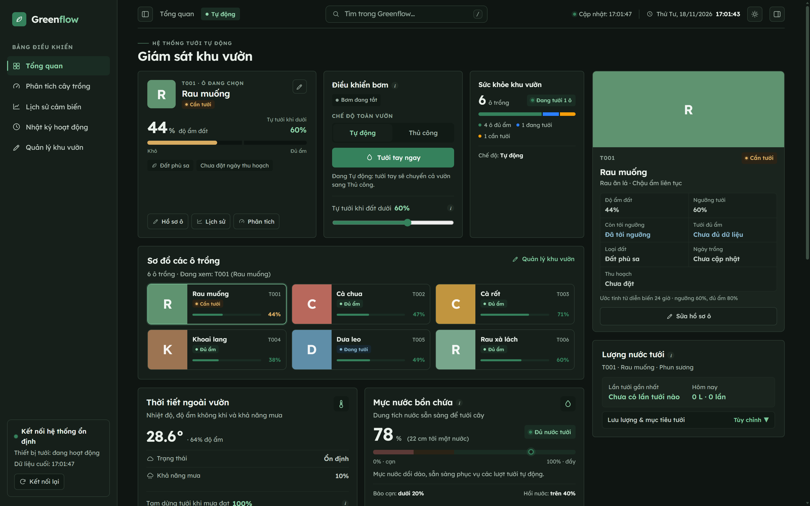
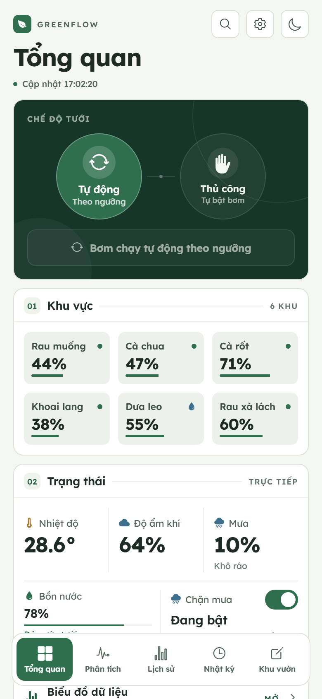
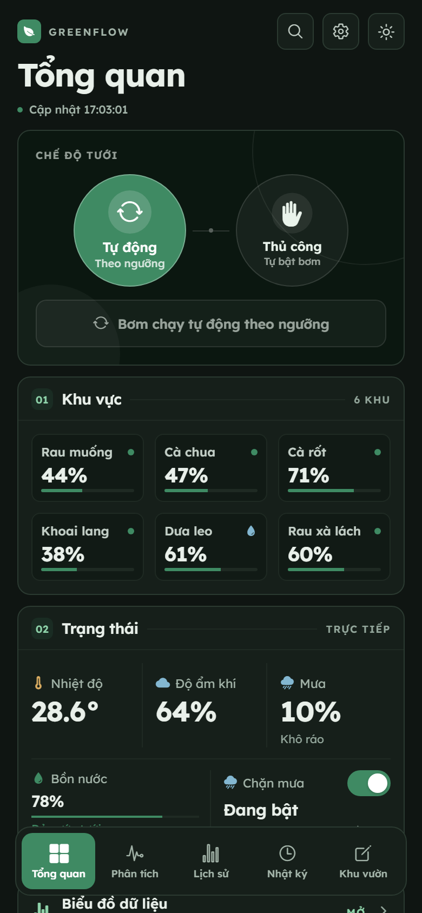
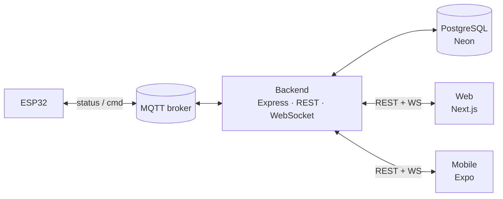

# Frontend — Web Dashboard & Mobile App

Hai giao diện cho cùng một hệ thống tưới thông minh. **Web** dùng để giám sát toàn cảnh trên màn hình lớn, **Mobile** dùng để theo dõi và điều khiển khi đang ở ngoài vườn. Cả hai đọc chung cấu hình từ Backend, nhận telemetry qua WebSocket và gửi lệnh qua REST — không kết nối MQTT trực tiếp.

<div align="center">

**Web Dashboard**

 

<br/><br/>

**Mobile App**

 

</div>

---

## 1. Hai nền tảng trong một repo

| | **Web** (`Code/Frontend/Web`) | **Mobile** (`Code/Frontend/Mobile`) |
|---|---|---|
| Nền tảng | Trình duyệt, http://localhost:3000 | Android/iOS qua Expo Go hoặc APK |
| Công nghệ | Next.js 16 · React 19 · TypeScript · CSS thuần | Expo SDK 58 · React Native 0.88 · Expo Router · TypeScript |
| Bố cục | Bento dashboard, sidebar + cột phụ | Tab dưới, sheet trượt, thao tác bằng một tay |
| Điều hướng | 5 route, deep link `?zone=` và `?at=` | 5 tab + màn Cài đặt mở từ nút bánh răng |
| Dữ liệu | Mỗi trang tự mở WebSocket | Một provider dùng chung cho toàn app |
| Thông báo | Toast trong trình duyệt | Toast + push notification qua Expo |
| Điểm mạnh riêng | Bảng toàn cảnh, xuất CSV, phím tắt tìm kiếm | Vuốt đổi tab, kéo làm mới, push khi rời app |

Giao diện Mobile bám theo đúng token màu, chữ và nhịp bố cục của Web để hai nền tảng đọc như một hệ thống, nhưng thay sidebar bằng thanh tab nổi và thay panel bằng sheet.

---

## 2. Kiến trúc chung



Nguyên tắc chung của cả hai client:

- **Cấu hình là nguồn sự thật.** Frontend không hardcode ngưỡng tưới, tên cây hay loại đất. Mỗi lần mở app/trang, client gọi `GET /api/config` (hoặc `/api/devices/:id/config`) rồi dựng 6 khu `T001`–`T006`.
- **Telemetry đi một chiều từ Backend.** Backend giữ kết nối MQTT và đẩy dữ liệu qua WebSocket `/realtime` dưới ba loại message: `telemetry`, `device-status`, `command-result`.
- **Lệnh đi qua REST.** Client gửi `POST /api/devices/:id/commands`; Backend publish MQTT và chờ thiết bị xác nhận trong 12 giây. Kết quả `confirmed`/`timeout` quay lại qua WebSocket.
- **Mất kết nối thì không hiển thị số liệu chết.** Khi thiết bị offline, cả hai client xoá số đo cảm biến và hiện trạng thái "Chưa có dữ liệu" thay vì giữ giá trị cũ.
- **Tự kết nối lại.** WebSocket retry theo exponential backoff, tối đa 15 giây; trạng thái MQTT thật lấy từ `GET /api/health` mỗi 10 giây.

### API mà frontend sử dụng

| Method | Endpoint | Dùng cho |
|---|---|---|
| GET | `/api/health` | Trạng thái MQTT + database, số client realtime |
| GET | `/api/config` | Danh sách 6 khu, ngưỡng, loại đất, giới hạn hợp lệ |
| GET | `/api/devices/:id/telemetry/latest` | Snapshot cuối cùng khi vừa mở app |
| GET | `/api/devices/:id/telemetry/history` | Biểu đồ theo `zoneId`, `from`, `to`, `bucketMs` |
| POST | `/api/devices/:id/commands` | Bật/tắt bơm, đổi chế độ, đổi ngưỡng, weather gate |
| GET | `/api/devices/:id/commands` | Nhật ký lệnh |
| GET | `/api/devices/:id/config/changes` | Lịch sử đổi ngưỡng |
| PUT | `/api/devices/:id/config/zones/:zoneId` | Lưu ngưỡng, lưu lượng, mục tiêu nước |
| PUT | `/api/devices/:id/config/soil` | Đổi loại đất của cả vườn |
| PUT | `/api/devices/:id/config/rain` | Ngưỡng mưa |
| GET | `/api/devices/:id/config/advice` | Gợi ý ngưỡng cho cả 6 khu |
| POST | `/api/devices/:id/config/advice/apply` | Áp dụng gợi ý cho cả vườn |
| GET | `/api/devices/:id/config/zones/:zoneId/advice` | Gợi ý cho một khu |
| GET/PUT | `/api/devices/:id/config/zones/:zoneId` | Hồ sơ cây (tên, nhóm, ngày trồng, ghi chú) |
| POST/DELETE | `/api/devices/:id/config/zones/:zoneId/photo` | Ảnh nhận diện khu vực |
| GET | `/api/devices/:id/watering` | Lượt tưới gần nhất, số lít hôm nay |
| POST | `/api/devices/:id/push-tokens` | Đăng ký Expo push token (Mobile) |
| POST | `/api/devices/:id/notifications/test` | Gửi thử thông báo (Mobile) |

---

## 3. Các màn hình và chức năng

| Màn hình | Web | Mobile | Nội dung chính |
|---|:---:|:---:|---|
| Tổng quan | `/` | Tab 1 | Trạng thái vườn, điều khiển bơm, sơ đồ 6 ô, thời tiết, bồn nước |
| Phân tích cây trồng | `/analysis` | Tab 2 | Đánh giá sức khoẻ, vùng an toàn, khuyến nghị (Web có thêm điểm số và chăm sóc định kỳ) |
| Lịch sử cảm biến | `/history` | Tab 3 | Đồ thị 4 chỉ số theo 1 giờ / 24 giờ / 7 ngày |
| Nhật ký hoạt động | `/activity` | Tab 4 | Lệnh đã gửi, đổi ngưỡng, trạng thái xác nhận |
| Quản lý khu vườn | `/garden` | Tab 5 | Hồ sơ cây, ảnh, loại đất (Web có thêm áp dụng gợi ý cho cả vườn) |
| Cài đặt | — | Nút bánh răng | Theme, weather gate, thiết bị, thông báo |

### Tổng quan

**Web** chia thành hai cột:

- Hàng thao tác nhanh: ô đang chọn (`ZoneSpotlightCard`), điều khiển bơm + ngưỡng (`PumpControlCard`), thẻ sức khoẻ toàn vườn (`GardenHealthCard`).
- Sơ đồ 6 ô trồng, bấm vào ô để đổi khu vực đang xem.
- Thời tiết (nhiệt độ, độ ẩm, mưa, ngưỡng mưa, bật/tắt hoãn mưa) và mực nước bồn qua HC-SR04.
- Tab "Diễn biến 6 giờ" và "Hoạt động gần đây"; bên dưới là khuyến nghị tưới theo đất.
- Cột phải: hồ sơ cây + ảnh của ô đang chọn, thông số nước (lưu lượng, mục tiêu lít, số lít đã tưới, lượt tưới gần nhất).

**Mobile** gọn hơn:

- Header hiện trạng thái online, thời điểm mẫu cuối, nút tìm kiếm và bánh răng.
- `ModeDock` chuyển Tự động / Thủ công và bật tắt bơm; cảnh báo khi bật bơm lúc đang AUTO.
- Dải chỉ số nhanh, hàng môi trường, lưới 6 khu; chạm một khu mở sheet chi tiết.
- **Kéo tiếp lên khi đã ở cuối trang** để mở `ChartSheet` (4 chỉ số, chọn 1 giờ / 24 giờ / 7 ngày, mặc định 7 ngày), kéo xuống để tải lại cấu hình.

### Phân tích cây trồng

- **Web** chấm điểm sức khoẻ 0–100 có trọng số: độ ẩm đất 60, khí hậu 25, nguồn nước 15; thiếu nguồn nào thì điểm tính lại trên phần nguồn còn biết. Độ ẩm quy đổi theo thời gian đại diện của từng mẫu (bỏ khoảng trống telemetry dài hơn 2 bucket); trạng thái phân biệt "đang tưới" với "nguy cơ" theo chế độ AUTO/MANUAL và thời gian khô. Khí hậu chấm theo mẫu DHT22 mới nhất, với dải dễ chịu đổi theo mùa (mùa mưa tháng 5–10, mùa khô các tháng còn lại) và loại đất (đất cát hạ trần nhiệt độ). Nguồn nước chấm theo mức nước bồn. Đi kèm là đồng hồ điểm và một câu kết luận ngắn.
- **Mobile** không hiển thị điểm số mà đánh giá theo cách tương tự để ra kết luận trạng thái (tốt / cần chú ý / nguy hiểm), kèm % thời gian đất nằm trong ngưỡng và trung bình / nhỏ nhất / lớn nhất.
- Cả hai vẽ đồ thị độ ẩm với **vùng an toàn lấy theo ngưỡng đang cấu hình** (không phải hằng số) và liệt kê khuyến nghị theo tình trạng hiện tại (khô, úng, mưa, bồn cạn, thiết bị offline…).
- Chỉ Web có mục **"Chăm sóc định kỳ"**: khung giờ tưới tham khảo theo nhóm cây, mẹo theo giai đoạn sinh trưởng (cây con, sinh dưỡng, ra hoa, củ quả, thu hoạch) và theo loại đất; kèm nút áp dụng gợi ý cho khu đang chọn.
- Mobile chỉnh ngưỡng ở tab Khu vườn → Tưới. Hệ thống vẫn tưới theo độ ẩm; khung giờ chỉ để tham khảo.

### Lịch sử cảm biến

- Bốn chỉ số: độ ẩm đất, nhiệt độ, độ ẩm không khí, mưa.
- Ba khoảng: 1 giờ (bucket 30 giây), 24 giờ (5 phút), 7 ngày (30 phút); dữ liệu tự làm mới mỗi 30 giây.
- Web có thêm deep link thời điểm: từ Nhật ký bấm sang Lịch sử sẽ mở đúng khu và đúng mốc thời gian (`?zone=T003&at=...`).

### Nhật ký hoạt động

- Gộp hai nguồn: lệnh gửi xuống thiết bị và lịch sử đổi ngưỡng.
- Lọc theo loại (bơm, chế độ, ngưỡng, hoãn mưa) và theo khoảng thời gian; hiển thị trạng thái "chờ xác nhận / đã xác nhận / không phản hồi".
- Web xuất được CSV để đưa vào báo cáo; bấm một dòng để nhảy sang biểu đồ lịch sử tại đúng thời điểm.

### Quản lý khu vườn

- Hồ sơ từng khu: tên cây, nhóm cây, ngày trồng, số ngày tới thu hoạch, ghi chú, ảnh nhận diện.
- Ảnh được nén trước khi gửi: Web resize tối đa 1280px, JPEG 0.85; Mobile dùng image picker chất lượng 0.6. Backend lưu Cloudinary nếu có cấu hình, ngược lại lưu local.
- Kế hoạch đất chung (chỉ trên Web): đổi loại đất và áp dụng gợi ý ngưỡng cho cả 6 khu.
- Mobile chia hai mục **Cây trồng / Tưới**, vuốt ngang để đổi mục; mỗi lần quay lại tab sẽ tải lại cấu hình vì hồ sơ có thể vừa sửa trên Web.

### Cài đặt (Mobile)

- Theme: theo máy / sáng / tối, lưu bằng AsyncStorage.
- Bật tắt chặn tưới khi mưa (weather gate).
- Thông tin thiết bị, tải lại cấu hình.
- Bật thông báo, gửi thử, xem số máy đã đăng ký.
- Ghi công thư viện và phiên bản.

---

## 4. Web — chi tiết kỹ thuật

### Công nghệ

Next.js 16 (App Router), React 19, TypeScript 6, ESLint 10. Không dùng UI kit, state library hay chart library: toàn bộ giao diện là component React + CSS thuần, biểu đồ vẽ bằng SVG.

### Cấu trúc thư mục

```text
Web/
├─ app/                        # Route mỏng: metadata + Suspense
│  ├─ layout.tsx               # Font Lexend, script áp theme trước khi vẽ
│  ├─ page.tsx                 # /
│  ├─ analysis/page.tsx        # /analysis
│  ├─ history/page.tsx         # /history
│  ├─ activity/page.tsx        # /activity
│  └─ garden/page.tsx          # /garden
├─ src/
│  ├─ App.tsx                  # Trang Tổng quan
│  ├─ AnalysisApp.tsx          # Trang Phân tích
│  ├─ HistoryApp.tsx           # Trang Lịch sử
│  ├─ ActivityApp.tsx          # Trang Nhật ký
│  ├─ components/              # Hơn 30 component giao diện
│  ├─ hooks/                   # useMqtt, useActivity, useZoneHistory…
│  ├─ lib/                     # API client, phân tích, tìm kiếm, định dạng
│  ├─ styles/                  # 15 file CSS theo miền + thư mục motion/
│  ├─ garden-data.ts           # Type và dữ liệu nhóm cây / loại đất
│  ├─ notifications.ts         # Kiểu toast
│  └─ App.css                  # Import các lớp style theo thứ tự
├─ next.config.ts
├─ eslint.config.js
└─ tsconfig.json
```

### Các file quan trọng

| Nhóm | File | Vai trò |
|---|---|---|
| Realtime | `src/hooks/useMqtt.ts` | Trái tim của Web: tải cấu hình, mở WebSocket, áp telemetry, gửi lệnh, optimistic update, kiểm tra khoảng ngưỡng |
| Lịch sử | `src/hooks/useZoneHistory.ts`, `src/components/HistoryChart.tsx` | Tải mẫu theo bucket và vẽ SVG |
| Nhật ký | `src/hooks/useActivity.ts` | Gộp lệnh + thay đổi ngưỡng, phân loại sự kiện |
| Nước | `src/hooks/useWatering.ts`, `useWateredLiters.ts` | Lượt tưới từ Backend và ước tính số lít đang tưới |
| Dự báo | `src/hooks/useMoistureForecast.ts` | Ước tính tốc độ khô/ẩm từ lịch sử để gợi ý thời điểm |
| Phân tích | `src/lib/analysis.ts` | Điểm sức khoẻ, khuyến nghị, chăm sóc định kỳ |
| API | `src/lib/backend.ts`, `src/lib/garden-api.ts` | Địa chỉ Backend, hàm gọi config/advice/ảnh |
| Điều hướng | `src/lib/zone-link.ts`, `src/lib/sync.ts` | Giữ `zone` khi đổi trang, đồng bộ `at` giữa Lịch sử và Nhật ký |
| Tìm kiếm | `src/lib/search.ts`, `src/components/SearchBox.tsx` | Command palette tìm trang và khu vực |
| Ảnh | `src/lib/image.ts` | Nén ảnh bằng canvas trước khi upload |
| Khung trang | `src/components/Sidebar.tsx`, `Topbar.tsx` | Sidebar, thanh trên, nút ẩn/hiện panel |
| Ô trồng | `GardenBoard`, `ZoneSpotlightCard`, `ZoneConfigCard`, `ZoneAdvicePanel` | Sơ đồ, thẻ khu đang chọn, thông số nước, khuyến nghị |

### Luồng trạng thái

Mỗi trang là một client component độc lập và tự gọi `useMqtt`; không có global store.

1. **Tải cấu hình** một lần khi mount. `zonesFromConfig` dựng 6 khu; nếu lỗi thì hiện thẻ "Không thể tải cấu hình" kèm nút thử lại.
2. **Mở WebSocket** tới `/realtime`. Telemetry được chuẩn hoá: làm tròn 1 chữ số, kẹp 0–100, `null` khi cảm biến lỗi.
3. **Ngưỡng có chủ quyền riêng:** ngưỡng bật lấy từ cấu hình Backend; ngưỡng dừng phản ánh giá trị thiết bị đang dùng, trừ 5 giây ngay sau khi người dùng vừa kéo (chờ lệnh áp xuống).
4. **Optimistic update:** đổi chế độ và weather gate giữ trạng thái mới 3 giây; nếu Backend từ chối thì trả UI về giá trị cũ.
5. **Slider ngưỡng:** debounce 400ms, chỉ gửi giá trị cuối. Ngưỡng dừng phải cao hơn ngưỡng bật ít nhất 10 điểm, khớp firmware; vi phạm thì chặn và hiện toast.
6. **Lệnh xong** thì tăng `commandVersion`, kích hoạt tải lại nhật ký và số lít tưới.
7. **Offline:** xoá nhiệt độ, độ ẩm, mưa, mực nước, trạng thái bơm; các ô hiện "Chưa có dữ liệu".

### Điều hướng và deep link

- Năm route dùng chung tham số `?zone=T00x`, nên đổi trang vẫn giữ khu đang xem.
- Lịch sử và Nhật ký dùng thêm `?at=<timestamp>` để mở đúng mốc thời gian khi bấm chéo từ trang kia.
- Thanh tìm kiếm mở bằng phím `/`, điều hướng bằng ↑ ↓, Enter để chọn, Esc để đóng; tìm cả trang và khu vực.
- Theme (`greenflow:theme`) và trạng thái ẩn/hiện sidebar, cột phải (`greenflow:panel:nav|rail`) lưu trong localStorage. Một script trong `app/layout.tsx` áp các giá trị này trước khi React hydrate để không nháy giao diện.

### Giao diện

- **Token màu** khai báo bằng CSS variable cho cả light/dark; `data-theme` trên `<html>` quyết định bảng màu. Mobile dùng lại đúng bảng màu này trong `src/theme/palette.ts`.
- Font **Lexend** (hỗ trợ tiếng Việt), icon SVG tự vẽ, dropdown và tooltip tự làm.
- Bố cục bento: cột chính rộng + cột phụ dính (sticky). Dưới 1280px ẩn sidebar, thay bằng thanh điều hướng cuộn ngang; dưới 680px chuyển sang thanh tab cố định ở đáy và bố cục một cột; dưới 480/400/340px tiếp tục thu gọn thẻ và chữ.
- CSS chia theo miền (`dashboard`, `garden`, `analysis`, `history`, `manager`…) và một thư mục `motion/` riêng cho animation, có tôn trọng `prefers-reduced-motion`.
- Các nút, ô chọn, tab đều có `aria-*`, focus ring và nhãn cho screen reader.

### Kiểm tra

```bash
cd Code/Frontend/Web
npx tsc --noEmit
npm run lint
npm run build
```

---

## 5. Mobile — chi tiết kỹ thuật

### Công nghệ

Expo SDK 58, React Native 0.88, React 19, Expo Router (typed routes), TypeScript. Giao diện dùng Reanimated 4 + Gesture Handler 3 cho chuyển động và vuốt, `react-native-svg` cho biểu đồ, AsyncStorage cho theme, Expo Notifications cho push, Expo Image Picker cho ảnh, Lexend + Ionicons cho chữ và icon.

### Cấu trúc thư mục

```text
Mobile/
├─ app.json / eas.json         # Cấu hình Expo và build
├─ google-services.json        # Cấu hình client FCM (được commit)
├─ src/
│  ├─ app/                     # Màn hình theo file-based routing
│  │  ├─ _layout.tsx           # Font, theme, provider, thanh tab
│  │  ├─ index.tsx             # Tổng quan
│  │  ├─ analysis.tsx          # Phân tích
│  │  ├─ history.tsx           # Lịch sử
│  │  ├─ activity.tsx          # Nhật ký
│  │  ├─ garden.tsx            # Khu vườn (Cây trồng / Tưới)
│  │  └─ settings.tsx          # Cài đặt
│  ├─ api/                     # client, config, telemetry, commands, garden…
│  ├─ providers/               # Garden, Theme, Toast, Notifications
│  ├─ hooks/                   # useHistory, useActivity
│  ├─ components/
│  │  ├─ layout/               # Screen, PageHeader, HeaderActions
│  │  ├─ navigation/           # GlassTabBar
│  │  ├─ overview/             # ModeDock, MetricStrip, EnvRow, ChartSheet, ZoneSheet…
│  │  ├─ garden/               # GardenSettings, ZoneProfileEditor
│  │  ├─ history/              # HistoryChart
│  │  ├─ settings/             # ZoneSettingsForm
│  │  ├─ ui/                   # Panel, Sheet, Button, Toggle, LedgerTabs…
│  │  └─ zones/                # ZoneGrid, ZonePicker
│  ├─ theme/                   # palette, spacing, typography, useThemedStyles
│  ├─ utils/                   # analysis, crops, format, haptics
│  └─ lib/notifications.ts     # Quyền, kênh Android, Expo push token
├─ android/                    # Native project (prebuild)
└─ scripts/
```

### Các file quan trọng

| Nhóm | File | Vai trò |
|---|---|---|
| Kết nối | `src/api/config.ts` | Tự chọn địa chỉ Backend, WS URL, `DEVICE_ID`, timeout 12 giây |
| HTTP | `src/api/client.ts` | `fetch` có AbortController và timeout 8 giây, lỗi `ApiError` |
| Trạng thái | `src/providers/GardenProvider.tsx` | Config, telemetry, WebSocket, lệnh, health MQTT, reconnect |
| Theme | `src/providers/ThemeProvider.tsx` | system/light/dark, lưu AsyncStorage `greenflow.theme` |
| Thông báo | `src/providers/NotificationsProvider.tsx`, `src/lib/notifications.ts` | Quyền, token Expo, kênh Android, gửi thử |
| Khung trang | `src/components/layout/Screen.tsx` | Safe area, pull-to-refresh, pull-up, vuốt đổi tab |
| Tab | `src/components/navigation/GlassTabBar.tsx` | Thanh tab nổi, pill trượt, icon nảy, haptic |
| Biểu đồ | `src/components/history/HistoryChart.tsx`, `overview/ChartSheet.tsx` | SVG + threshold band |
| Phân tích | `src/utils/analysis.ts` | Kết luận trạng thái, % trong ngưỡng và khuyến nghị |
| Cây trồng | `src/utils/crops.ts` | Nhóm cây, khung giờ tưới, ngày thu hoạch |

### Provider và dữ liệu

Thứ tự provider trong `_layout.tsx`:

```text
ThemeProvider → ToastProvider → NotificationsProvider → GardenProvider → Tabs
```

`GardenProvider` giữ toàn bộ trạng thái sống của app:

- Tải cấu hình một lần, lấy snapshot telemetry cuối qua REST để có dữ liệu ngay khi mở app.
- Mở một WebSocket duy nhất cho cả 5 tab; nhận `telemetry`, `device-status`, `command-result`.
- Cứ 10 giây hỏi `/api/health` để biết Backend còn nối MQTT hay không.
- Lệnh đang chờ được đánh dấu `pending`; quá `COMMAND_TIMEOUT_MS + 1s` thì báo "không phản hồi".
- `liveStatusRef` bảo vệ trạng thái online thật: snapshot REST cũ không được kéo thiết bị về offline khi WebSocket đã báo online.
- Mobile tự chuẩn hoá số đo giống Web: làm tròn 1 chữ số, kẹp servo 0–180, ẩn số đo khi offline.

### Tương tác đặc trưng

- **Vuốt ngang để đổi tab** (54px hoặc vận tốc 520px/s). Ở tab Khu vườn, thao tác vuốt được xử lý trước để đổi giữa Cây trồng và Tưới; vuốt ở tab đầu/cuối thì rơi xuống xử lý tab.
- **Kéo xuống để làm mới** ở cả 5 tab chính; tab Khu vườn tải lại cấu hình vì hồ sơ có thể vừa sửa trên Web.
- **Kéo tiếp lên khi đã ở đáy** ở Tổng quan để mở sheet biểu đồ lịch sử.
- Sheet trượt cho chi tiết khu, tìm kiếm, biểu đồ; `Reveal` cho hiệu ứng vào trang, `AnimatedNumber` cho số liệu, `PressableScale` cho phản hồi chạm.
- Rung nhẹ (`expo-haptics`) khi đổi tab, đổi bộ lọc, bấm nút chính.

### Theme và phong cách

- `lightPalette` và `darkPalette` lấy đúng token của Web; `useThemedStyles` chuyển palette thành StyleSheet, đổi theme là mọi màn hình đổi theo.
- Theme mặc định "Theo máy", lưu lựa chọn của người dùng qua AsyncStorage.
- Lexend 5 độ đậm; Ionicons cặp filled/outline để tab đang chọn đậm hơn.
- Không dùng gradient trang trí: panel phẳng, viền mảnh, khoảng thở rộng — cùng ngôn ngữ với Web.

### Thông báo đẩy

- Mobile xin quyền, lấy Expo push token và đăng ký với Backend theo `deviceId`.
- Android tạo kênh `alerts` với độ ưu tiên cao, rung và đèn màu xanh.
- Nút "Gửi thử" ưu tiên gửi qua Backend → Expo nếu đã có máy đăng ký; chưa có thì gửi thông báo cục bộ để kiểm tra quyền/kênh.
- Expo Go không lấy được token từ xa trên Android; muốn nhận push thật cần dev build/APK. Ứng dụng không lưu lịch sử thông báo trong app.

### Cách Mobile tìm Backend

```text
1. EXPO_PUBLIC_API_URL trong .env        → dùng nếu có
2. Chạy trên web                        → http://<hostname>:3001
3. Expo Go / dev client                 → http://<IP trong hostUri>:3001
```

`WS_URL` suy ra từ `API_URL` bằng cách đổi `http` → `ws` và thêm `/realtime`. Android bật `usesCleartextTraffic` để gọi Backend HTTP trong LAN khi demo. Giá trị `EXPO_PUBLIC_API_URL` được nhúng lúc build, nên APK phát cho người khác phải trỏ tới Backend mà người đó truy cập được (ví dụ Render).

### Kiểm tra

```bash
cd Code/Frontend/Mobile
npx tsc --noEmit
npm run lint
```

---

## 6. Web và Mobile có gì khác nhau

| Chức năng | Web | Mobile |
|---|:---:|:---:|
| Giám sát realtime, điều khiển bơm, đổi chế độ | ✓ | ✓ |
| Chỉnh ngưỡng, lưu lượng, mục tiêu nước | ✓ | ✓ |
| Weather gate, ngưỡng mưa | ✓ | ✓ (weather gate) |
| Biểu đồ lịch sử 4 chỉ số | ✓ | ✓ |
| Điểm sức khoẻ 0–100 | ✓ | — |
| Đánh giá trạng thái, % trong ngưỡng và khuyến nghị | ✓ | ✓ |
| Chăm sóc định kỳ theo nhóm cây / loại đất | ✓ | — |
| Hồ sơ cây + ảnh nhận diện | ✓ | ✓ |
| Đổi loại đất và áp dụng gợi ý cho cả vườn | ✓ | — |
| Nhật ký hoạt động | ✓ + CSV | ✓ |
| Deep link theo khu và thời điểm | ✓ | Một phần (`?zone`, `?view`) |
| Ẩn/hiện sidebar, cột phụ | ✓ | — |
| Push notification | — | ✓ |
| Vuốt đổi tab, kéo làm mới | — | ✓ |

Hai client dùng chung `deviceId` (`esp32-garden-01`) và cùng đọc/ghi một bộ cấu hình trong PostgreSQL, nên sửa trên Web thì mở lại tab Khu vườn trên Mobile sẽ thấy nội dung mới.

---

## 7. Chạy frontend

Yêu cầu chung: Node.js 22 và Backend đang chạy ở `http://localhost:3001` (xem [Backend README](../Backend/README.md)).

### Web — http://localhost:3000

```powershell
cd Code\Frontend\Web
npm install
```

Tạo `Code/Frontend/Web/.env.local`:

```dotenv
NEXT_PUBLIC_BACKEND_URL=http://localhost:3001
```

```powershell
npm run dev
```

### Mobile

```powershell
cd Code\Frontend\Mobile
Copy-Item .env.example .env
npm install
npm start
```

`.env`:

```dotenv
EXPO_PUBLIC_API_URL=http://192.168.1.10:3001
```

- Chạy trên điện thoại thật: dùng IPv4 LAN của máy tính, **không dùng `localhost`**, và mở firewall cổng 3001.
- Expo Go: quét QR trong ứng dụng Expo Go. Nếu không đặt `EXPO_PUBLIC_API_URL`, app tự lấy IP từ Metro.
- Bản APK/dev build: `npm run android` hoặc build bằng EAS; nhớ đặt `EXPO_PUBLIC_API_URL` trỏ tới Backend mà máy cài app truy cập được.

---

## 8. Chất lượng và kiểm thử

Hiện dự án kiểm tra bằng typecheck, lint và smoke test thủ công; chưa có test tự động hay CI cho frontend.

Checklist thủ công khi sửa giao diện:

- Mở cả light và dark, kiểm tra tương phản và trạng thái hover/focus.
- Web: thu cửa sổ xuống 900px (bố cục một cột) và 680px (thanh tab nổi) để kiểm tra responsive.
- Mobile: thử vuốt đổi tab, kéo làm mới, mở sheet, xoay trạng thái offline bằng cách tắt Backend.
- Kiểm tra khi thiết bị offline: số đo phải biến mất, không còn số liệu cũ.
- Gửi một lệnh và chờ xác nhận; thử cả trường hợp timeout.

---

## 9. Hạn chế của frontend

- Chưa có đăng nhập/phân quyền; ai mở được URL đều điều khiển được bơm.
- Chỉ hỗ trợ một thiết bị/một khu vườn (`esp32-garden-01`); chưa có màn chọn thiết bị.
- Web tải cấu hình riêng cho từng trang và mỗi trang mở một WebSocket riêng — đơn giản nhưng không dùng chung cache.
- Không lưu telemetry khi mất mạng; khoảng offline bị hở trên biểu đồ.
- Biểu đồ tự vẽ bằng SVG nên chỉ có đường + vùng ngưỡng, chưa có zoom hay so sánh nhiều khu.
- Số lít đã tưới trên Web là ước tính từ thời gian bơm × lưu lượng cấu hình, không phải cảm biến lưu lượng.
- Push từ xa cần dev build/APK; Expo Go chỉ kiểm tra được thông báo cục bộ.
- Chưa có test tự động, E2E hay CI.

---

## 10. Tài liệu liên quan

- [README gốc](../../README.md) — tổng quan hệ thống, phần cứng, triển khai.
- [Backend README](../Backend/README.md) — REST API, MQTT, PostgreSQL, realtime.
- `Wokwi/Smart-Irrigation/` — firmware ESP32 và kịch bản mô phỏng.
