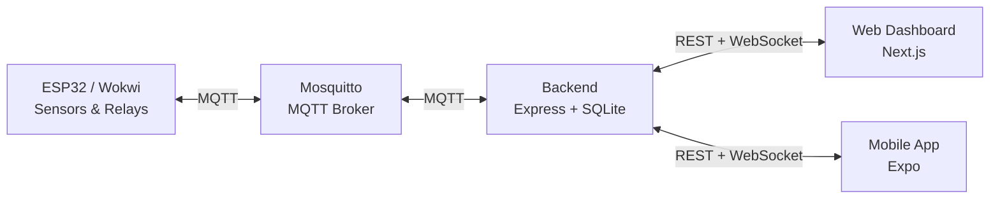

<div align="center">


# Smart Irrigation System

**Hệ thống IoT giám sát và điều khiển tưới cây theo dữ liệu cảm biến thời gian thực.**

[](https://www.espressif.com/)
[](https://platformio.org/)
[](https://nodejs.org/)
[](https://www.typescriptlang.org/)
[](https://nextjs.org/)
[](https://expo.dev/)

<p>
  <a href="#-tổng-quan">Tổng quan</a> ·
  <a href="#-kiến-trúc">Kiến trúc</a> ·
  <a href="#-tính-năng">Tính năng</a> ·
  <a href="#-khởi-chạy">Khởi chạy</a>
</p>

| 6 khu vực tưới | Realtime | Auto + Manual |
|:---:|:---:|:---:|
| `T001` → `T006` | MQTT + WebSocket | Tự động và thủ công |

</div>

## 🌱 Tổng quan

**Smart Irrigation System** là giải pháp IoT tự động hóa việc tưới cây dựa trên độ ẩm đất và điều kiện thời tiết.

- **ESP32** thu thập dữ liệu cảm biến và điều khiển phần cứng.
- **MQTT** truyền telemetry và lệnh giữa thiết bị với backend.
- **Backend** lưu dữ liệu vào SQLite, cung cấp REST API và WebSocket realtime.
- **Web Dashboard** giúp theo dõi, cấu hình và điều khiển hệ thống.
- **Mobile App** cung cấp giao diện điều khiển trên thiết bị di động.

Hệ thống hỗ trợ sáu khu vực trồng cây, định danh từ `T001` đến `T006`. Firmware có thể chạy trên phần cứng ESP32 thực tế hoặc mô phỏng bằng Wokwi.

## 🏗️ Kiến trúc



## ✨ Tính năng

### Giám sát

- Theo dõi độ ẩm đất của sáu khu vực theo thời gian thực.
- Hiển thị nhiệt độ, độ ẩm không khí và trạng thái mưa.
- Theo dõi trạng thái máy bơm và từng khu vực tưới.
- Xem biểu đồ lịch sử theo thời gian và khu vực.
- Lưu telemetry, lịch sử dữ liệu và nhật ký lệnh.

### Điều khiển

- Tự động tưới theo ngưỡng riêng của từng khu vực.
- Hysteresis giúp hạn chế đóng/mở bơm liên tục.
- Tạm dừng tưới khi phát hiện mưa bằng Weather Gate.
- Chuyển đổi giữa chế độ tự động và thủ công.
- Điều khiển toàn bộ hệ thống hoặc từng khu vực.
- Điều chỉnh và lưu ngưỡng tưới từ Web Dashboard.

## 🔌 Phần cứng

<div align="center">

</div>

Mô hình phần cứng tích hợp:

- ESP32 DevKit C V4.
- Sáu ngõ vào độ ẩm đất được chọn qua 74HC4067.
- DHT22 đo nhiệt độ và độ ẩm môi trường.
- Cảm biến mưa analog và digital.
- Sáu relay điều khiển độc lập các khu vực tưới.
- Servo điều khiển van nước tổng.
- Sáu LCD 1602 I2C hiển thị trạng thái từng khu vực.
- LED và buzzer phục vụ chỉ báo, cảnh báo.

## 🧰 Công nghệ

| Thành phần | Công nghệ |
|---|---|
| Firmware | C++ · Arduino Framework · PlatformIO |
| Mô phỏng | Wokwi |
| Giao tiếp | Wi-Fi · MQTT · PubSubClient |
| Backend | Node.js · TypeScript · Express 5 |
| Database | SQLite · `better-sqlite3` |
| Realtime | MQTT client · WebSocket |
| Web Dashboard | Next.js · React · TypeScript |
| Mobile App | Expo · React Native |

## 📁 Cấu trúc dự án

```text
Code/
├── Backend/              Backend API, MQTT Gateway và SQLite
└── Frontend/
    ├── Web/              Web Dashboard
    └── Mobile/           Ứng dụng mobile Expo
Wokwi/
└── Smart-Irrigation/     Firmware ESP32 và mô hình mô phỏng
```

## 🚀 Khởi chạy

### Yêu cầu

- Node.js 18+
- Mosquitto MQTT Broker
- PlatformIO hoặc Wokwi (cho firmware)

### 1. Khởi chạy Backend

```powershell
cd Code\Backend
npm install
Copy-Item .env.example .env
npm run dev
```

Backend mặc định chạy tại `http://localhost:3001` và kết nối MQTT tại `mqtt://127.0.0.1:1883`.

### 2. Khởi chạy Web Dashboard

```powershell
cd Code\Frontend\Web
npm install
npm run dev
```

Web Dashboard mặc định chạy tại `http://localhost:3000`.

### 3. Khởi chạy Mobile App

```powershell
cd Code\Frontend\Mobile
npm install
npm start
```

### 4. Chạy firmware

Mở thư mục `Wokwi\Smart-Irrigation` bằng PlatformIO hoặc Wokwi, sau đó nạp/chạy firmware ESP32.

## 📡 MQTT Topics

| Topic | Hướng | Mô tả |
|---|:---:|---|
| `smart-irrigation/status` | ESP32 → Backend | Telemetry thiết bị |
| `smart-irrigation/cmd` | Backend → ESP32 | Lệnh điều khiển |

## 📚 Tài liệu kỹ thuật

- [Backend README](Code/Backend/README.md)
- [PlatformIO configuration](Wokwi/Smart-Irrigation/platformio.ini)
- [Wokwi circuit diagram](Wokwi/Smart-Irrigation/diagram.json)

## 📝 Ghi chú

- Firmware hỗ trợ chạy trên ESP32 thật hoặc mô phỏng bằng Wokwi.
- Backend lưu dữ liệu trong `Code\Backend\data\smart-irrigation.db`.
- Ngưỡng tưới được lưu bền vững trong SQLite và được đồng bộ lại với firmware sau khi thiết bị khởi động lại.
