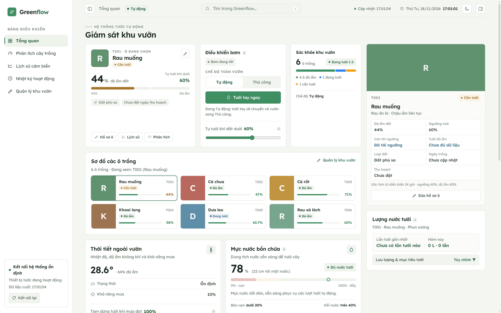
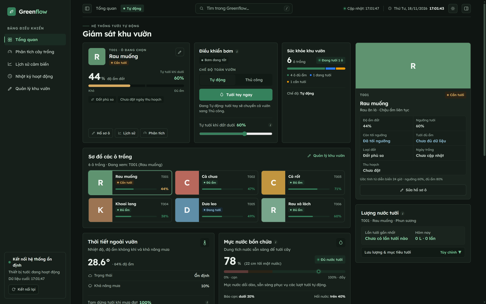
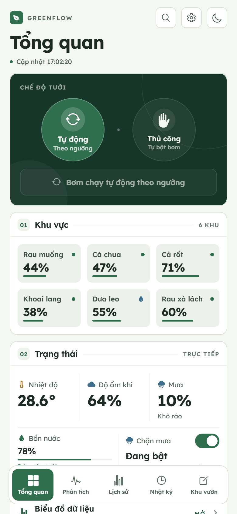
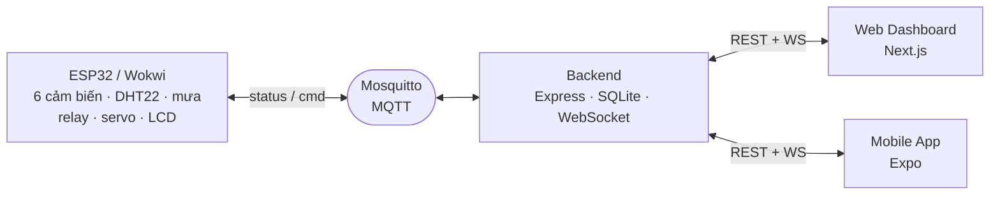

<div align="center">


# Smart Irrigation System

**Tưới cây tự động, tự chủ ngay tại thiết bị.**
ESP32 đọc cảm biến và quyết định tưới; Web Dashboard và Mobile App giám sát, cấu hình và điều khiển từ xa.

<br/>

[](https://www.espressif.com/)
[](https://platformio.org/)
[](https://mosquitto.org/)
[](https://nodejs.org/)
[](https://www.typescriptlang.org/)
[](https://nextjs.org/)
[](https://expo.dev/)

<a href="#giao-diện">Giao diện</a> ·
<a href="#kiến-trúc">Kiến trúc</a> ·
<a href="#tính-năng">Tính năng</a> ·
<a href="#phần-cứng">Phần cứng</a> ·
<a href="#khởi-chạy">Khởi chạy</a> ·
<a href="#lưu-ý">Lưu ý</a>

<br/>

| **06** khu vực | **2 giây** / mẫu | **Realtime** | **Offline-first** |
|:---:|:---:|:---:|:---:|
| T001 – T006 | MQTT + WebSocket | Tự động & thủ công | Mất mạng vẫn tưới |

</div>

---

## Giao diện

<div align="center">

**Web Dashboard**

 

<br/><br/>

**Mobile App**

 

</div>

---

## Kiến trúc

<div align="center">



</div>

**Dữ liệu** — ESP32 đọc cảm biến mỗi 2 giây, publish retained; backend lưu SQLite và broadcast WebSocket tới Web/Mobile.

**Lệnh** — REST → MQTT → ESP32 thực thi → telemetry xác nhận; quá 12 giây không phản hồi thì lệnh chuyển `timeout`.

**Mất mạng** — vòng điều khiển cục bộ vẫn chạy theo ngưỡng lưu trong NVS; khi kết nối lại, retained telemetry cập nhật trạng thái mới nhất.

---

## Tính năng

### Giám sát

- Độ ẩm 6 khu vực, nhiệt độ/độ ẩm không khí và tình trạng mưa theo thời gian thực.
- Mực nước bồn qua HC-SR04, trạng thái bơm, chế độ AUTO/MANUAL, online/offline.
- Biểu đồ lịch sử, nhật ký lệnh, lượng nước đã tưới và ước tính thời gian tới ngưỡng.

### Điều khiển

- Ngưỡng bật/dừng riêng từng khu vực, chỉnh từ Web và Mobile, đồng bộ lại khi thiết bị khởi động.
- Weather Gate tự hoãn tưới khi mưa, chặn bơm ở cả AUTO lẫn MANUAL.
- Bơm toàn hệ thống hoặc từng vùng; MANUAL đặt mục tiêu lít; nút vật lý dự phòng.

### An toàn

- Mất Internet vẫn tưới; tối đa 10 phút/vùng rồi nghỉ và tự tiếp tục khi đất chưa đủ ẩm.
- Tự thoát MANUAL sau 10 phút, chống chạy khô khi bồn cạn, cảnh báo bằng LCD và còi.

### Dữ liệu

- SQLite WAL, tự dọn dữ liệu cũ sau 30 ngày.
- Hồ sơ cây theo khu vực: tên, nhóm, ghi chú, ảnh; gợi ý ngưỡng theo loại đất và nhóm cây.
- Thông báo đẩy tới điện thoại khi khu vực cần tưới hoặc có sự kiện bất thường.

---

## Phần cứng

<div align="center">

</div>

ESP32 DevKit C V4 · 6 cảm biến độ ẩm qua MUX 74HC4067 · DHT22 · cảm biến mưa · 6 relay · servo van tổng · 6 LCD 1602 I2C · HC-SR04 · LED, còi và 2 nút nhấn.

Chạy thật hoặc mô phỏng trên Wokwi với 6 biến trở, chip mưa tùy chỉnh và mô phỏng động học đất.

---

## Khởi chạy

Node.js 22 và Mosquitto (cổng 1883) là đủ cho toàn bộ hệ thống.

```powershell
# Backend — http://localhost:3001
cd Code\Backend
npm install
npm run dev
```

```powershell
# Web Dashboard — http://localhost:3000
cd Code\Frontend\Web
npm install
npm run dev
```

```powershell
# Mobile App
cd Code\Frontend\Mobile
npm install
npm start
```

```powershell
# Firmware (Wokwi)
cd Wokwi\Smart-Irrigation
pio run
```

Chạy Mobile trên điện thoại thật: trỏ `EXPO_PUBLIC_API_URL` về IP LAN của máy tính, mở firewall cổng 3001.

---

## Lưu ý

- Prototype phục vụ đồ án, chưa triển khai thực địa.
- Chưa có auth/TLS; chỉ chạy trong mạng nội bộ.
- Mất điện lưới thì dừng — chưa có UPS dự phòng.
- Mất mạng không buffer telemetry, lịch sử bị hở đoạn offline.
- Gợi ý tưới là rule-based, chưa kiểm chứng nông học.

---

<div align="center">
<sub>Smart Irrigation System · IoT Project · 2026</sub>
</div>
