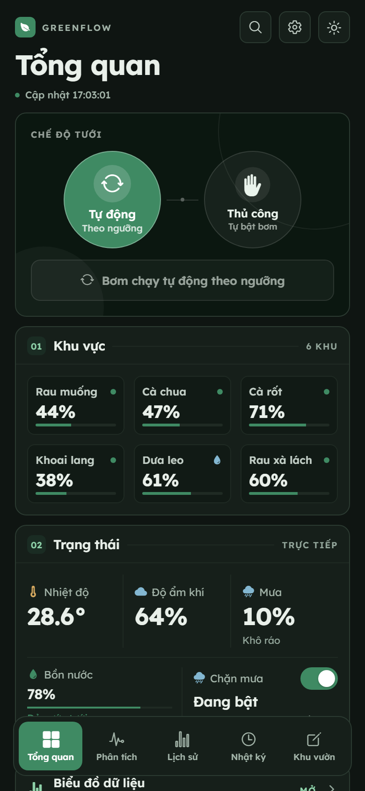
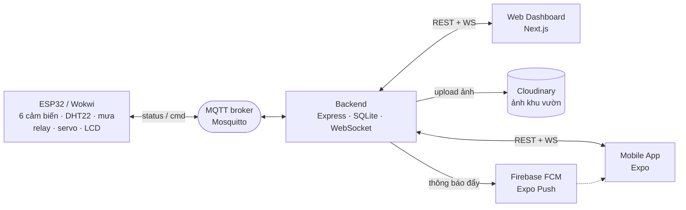

<div align="center">


# Smart Irrigation System

**Tưới cây tự động, tự chủ ngay tại thiết bị.**
ESP32 đọc cảm biến và quyết định tưới; Web Dashboard và Mobile App giám sát, cấu hình và điều khiển từ xa.

<br/>

[](https://www.espressif.com/)
[](https://platformio.org/)
[](https://mosquitto.org/)
[](https://nodejs.org/)
[](https://www.typescriptlang.org/)
[](https://nextjs.org/)
[](https://expo.dev/)
[](https://firebase.google.com/)
[](https://cloudinary.com/)

<a href="#giao-diện">Giao diện</a> ·
<a href="#kiến-trúc">Kiến trúc</a> ·
<a href="#tính-năng">Tính năng</a> ·
<a href="#phần-cứng">Phần cứng</a> ·
<a href="#khởi-chạy">Khởi chạy</a> ·
<a href="#dịch-vụ-ngoài">Dịch vụ ngoài</a> ·
<a href="#triển-khai">Triển khai</a>

<br/>

| **06** khu vực | **2 giây** / mẫu | **Realtime** | **Offline-first** |
|:---:|:---:|:---:|:---:|
| T001 – T006 | MQTT + WebSocket | Tự động & thủ công | Mất mạng vẫn tưới |

</div>

---

## Giao diện

<div align="center">

**Web Dashboard**

 

<br/><br/>

**Mobile App**

 

</div>

---

## Kiến trúc

<div align="center">



</div>

**Dữ liệu** — ESP32 đọc cảm biến mỗi 2 giây, publish retained; backend lưu SQLite và broadcast WebSocket tới Web/Mobile.

**Lệnh** — REST → MQTT → ESP32 thực thi → telemetry xác nhận; quá 12 giây không phản hồi thì lệnh chuyển `timeout`.

**Mất mạng** — vòng điều khiển cục bộ vẫn chạy theo ngưỡng lưu trong NVS; khi kết nối lại, retained telemetry cập nhật trạng thái mới nhất.

**Dịch vụ ngoài** — ảnh khu vườn lưu trên Cloudinary, thông báo đẩy đi qua Firebase FCM / Expo Push. Cả hai đều tùy chọn: thiếu cấu hình thì ảnh lưu local và push bị bỏ qua, phần còn lại vẫn chạy.

---

## Tính năng

### Giám sát

- Độ ẩm 6 khu vực, nhiệt độ/độ ẩm không khí và tình trạng mưa theo thời gian thực.
- Mực nước bồn qua HC-SR04, trạng thái bơm, chế độ AUTO/MANUAL, online/offline.
- Biểu đồ lịch sử, nhật ký lệnh, lượng nước đã tưới và ước tính thời gian tới ngưỡng.

### Điều khiển

- Ngưỡng bật/dừng riêng từng khu vực, chỉnh từ Web và Mobile, đồng bộ lại khi thiết bị khởi động.
- Weather Gate tự hoãn tưới khi mưa, chặn bơm ở cả AUTO lẫn MANUAL.
- Bơm toàn hệ thống hoặc từng vùng; MANUAL đặt mục tiêu lít; nút vật lý dự phòng.

### An toàn

- Mất Internet vẫn tưới; tối đa 10 phút/vùng rồi nghỉ và tự tiếp tục khi đất chưa đủ ẩm.
- Tự thoát MANUAL sau 10 phút, chống chạy khô khi bồn cạn, cảnh báo bằng LCD và còi.

### Dữ liệu

- SQLite WAL, tự dọn dữ liệu cũ sau 30 ngày.
- Hồ sơ cây theo khu vực: tên, nhóm, ghi chú, ảnh (Cloudinary, hoặc lưu local nếu chưa cấu hình); gợi ý ngưỡng theo loại đất và nhóm cây.
- Thông báo đẩy tới điện thoại khi khu vực cần tưới hoặc có sự kiện bất thường.

---

## Phần cứng

<div align="center">

</div>

ESP32 DevKit C V4 · 6 cảm biến độ ẩm qua MUX 74HC4067 · DHT22 · cảm biến mưa · 6 relay · servo van tổng · 6 LCD 1602 I2C · HC-SR04 · LED, còi và 2 nút nhấn.

Chạy thật hoặc mô phỏng trên Wokwi với 6 biến trở, chip mưa tùy chỉnh và mô phỏng động học đất.

---

## Cấu trúc thư mục

```text
.
├─ Code/
│  ├─ Backend/                 Express + SQLite + MQTT + WebSocket
│  └─ Frontend/
│     ├─ Web/                  Next.js dashboard
│     └─ Mobile/               Expo (React Native)
└─ Wokwi/
   └─ Smart-Irrigation/        Firmware PlatformIO (ESP32)
```

---

## Khởi chạy

Cần Node.js 22 và PlatformIO. MQTT broker là bắt buộc; Cloudinary và Firebase là tùy chọn.

### 1. MQTT broker

Dùng broker công khai có sẵn cho demo:

```text
test.mosquitto.org:1883
```

Hoặc chạy Mosquitto local ở cổng `1883`. Địa chỉ broker và topic phải khớp ở **hai nơi**:

- `Code/Backend/.env` → `MQTT_URL`, `MQTT_STATUS_TOPIC`, `MQTT_COMMAND_TOPIC`
- `Wokwi/Smart-Irrigation/src/config.h` → `MQTT_SERVER`, `MQTT_PORT`, `TOPIC_STATUS`, `TOPIC_CMD`

### 2. Backend — http://localhost:3001

```powershell
cd Code\Backend
Copy-Item .env.example .env
npm install
npm run dev
```

Mở `.env` và điền `MQTT_URL`, topic, cùng `CLOUDINARY_*` nếu muốn lưu ảnh trên Cloudinary.

### 3. Web Dashboard — http://localhost:3000

```powershell
cd Code\Frontend\Web
npm install
npm run dev
```

Tạo `Code/Frontend/Web/.env.local`:

```dotenv
NEXT_PUBLIC_BACKEND_URL=http://localhost:3001
```

### 4. Mobile App

```powershell
cd Code\Frontend\Mobile
Copy-Item .env.example .env
npm install
npm start
```

Trỏ `EXPO_PUBLIC_API_URL` về IP LAN của máy tính khi chạy trên điện thoại thật, và mở firewall cổng 3001.

### 5. Firmware (Wokwi)

```powershell
cd Wokwi\Smart-Irrigation
pio run
```

Extension Wokwi trên VS Code **không tự build**, nên mỗi lần sửa `config.h` phải chạy `pio run` rồi mới Start Simulation.

---

## Dịch vụ ngoài

| Dịch vụ | Dùng cho | Cấu hình | Thiếu cấu hình thì sao |
|---|---|---|---|
| **MQTT broker** | Telemetry và lệnh giữa ESP32 ↔ backend | `MQTT_URL` + topic trong `.env` và `config.h` | Không chạy được, đây là dịch vụ bắt buộc |
| **Cloudinary** | Lưu ảnh khu vườn | `CLOUDINARY_CLOUD_NAME`, `CLOUDINARY_API_KEY`, `CLOUDINARY_API_SECRET` | Ảnh lưu vào `Code/Backend/data/uploads`, phục vụ qua `/uploads/...` |
| **Firebase (FCM)** | Thông báo đẩy trên Android | `Code/Frontend/Mobile/google-services.json` + `expo-notifications` | App vẫn chạy, chỉ không nhận thông báo |
| **Expo Push** | Backend gửi thông báo tới thiết bị | `expo-server-sdk`; `EXPO_ACCESS_TOKEN` chỉ cần khi bật Enhanced Security | Push bị bỏ qua |

Ảnh Cloudinary được đặt tại `smart-irrigation/<deviceId>/<zoneId>`, upload ghi đè nên mỗi khu vực chỉ có một ảnh.

> `google-services.json` là cấu hình client, commit được. File service account `*firebase-adminsdk*.json` chứa private key nên **không được commit** — repo đã chặn bằng `.gitignore`.

---

## Triển khai

Backend chạy trên Render, deploy trực tiếp từ nhánh `main`:

| Thiết lập | Giá trị |
|---|---|
| Branch | `main` |
| Root Directory | `Code/Backend` |
| Build Command | `npm ci && npm run build` |
| Start Command | `npm start` |

Biến môi trường cần khai báo trong Render: `MQTT_URL`, `MQTT_STATUS_TOPIC`, `MQTT_COMMAND_TOPIC`, `WEB_ORIGIN`, `CLOUDINARY_CLOUD_NAME`, `CLOUDINARY_API_KEY`, `CLOUDINARY_API_SECRET` (và `EXPO_ACCESS_TOKEN` nếu dùng).

Kiểm tra sau khi deploy: `GET /api/health` trả `ok`, `mqtt: true`, `database.ok: true`.

> Ổ đĩa của Render là tạm: mỗi lần deploy/restart, SQLite trong `data/` bị tạo lại. Ảnh đã đẩy lên Cloudinary nên không mất.

---

## Lưu ý

- Prototype phục vụ đồ án, chưa triển khai thực địa.
- Bản demo public dùng MQTT broker công khai, chưa có auth/TLS: ai biết topic đều publish được. Chỉ dùng để demo, không dùng cho vườn thật.
- Mất điện lưới thì dừng — chưa có UPS dự phòng.
- Mất mạng không buffer telemetry, lịch sử bị hở đoạn offline.
- Gợi ý tưới là rule-based, chưa kiểm chứng nông học.

---

<div align="center">
<sub>Smart Irrigation System · IoT Project · 2026</sub>
</div>
