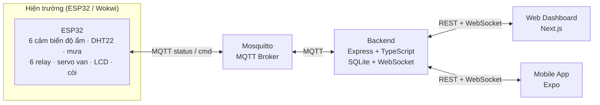

<div align="center">


# Smart Irrigation System

**Hệ thống IoT giám sát và điều khiển tưới cây theo dữ liệu cảm biến, tự chủ tại thiết bị khi mất kết nối.**

[](https://www.espressif.com/)
[](https://platformio.org/)
[](https://nodejs.org/)
[](https://www.typescriptlang.org/)
[](https://nextjs.org/)
[](https://expo.dev/)

<p>
  <a href="#-tổng-quan">Tổng quan</a> ·
  <a href="#-kiến-trúc">Kiến trúc</a> ·
  <a href="#-tính-năng">Tính năng</a> ·
  <a href="#-phần-cứng">Phần cứng</a> ·
  <a href="#-khởi-chạy">Khởi chạy</a> ·
  <a href="#-giới-hạn">Giới hạn</a>
</p>

| 6 khu vực tưới | Realtime | Tự động + Thủ công | Tự chủ khi mất mạng |
|:---:|:---:|:---:|:---:|
| `T001` → `T006` | MQTT + WebSocket | Có | Có |

</div>

## 🌱 Tổng quan

**Smart Irrigation System** là đồ án IoT tưới cây theo độ ẩm đất và điều kiện thời tiết. Hệ thống được thiết kế theo hướng **edge-first**: logic điều khiển nằm trong ESP32, backend và giao diện chỉ đóng vai trò giám sát, lưu trữ và điều khiển từ xa.

- **ESP32** đọc cảm biến, quyết định tưới và điều khiển relay/van.
- **MQTT** truyền telemetry và lệnh giữa thiết bị với backend.
- **Backend** lưu SQLite, cung cấp REST API, WebSocket realtime và engine gợi ý tưới.
- **Web Dashboard** theo dõi, cấu hình ngưỡng, quản lý hồ sơ cây và xem lịch sử.
- **Mobile App** cung cấp giao diện đồng hành cơ bản (đang hoàn thiện).

Hệ thống hỗ trợ sáu khu vực `T001`–`T006`, chạy trên phần cứng ESP32 thật hoặc mô phỏng bằng Wokwi. Bản hiện tại là **prototype phục vụ đồ án**, chưa phải hệ thống triển khai thực địa.

## 🏗️ Kiến trúc



**Luồng dữ liệu:** ESP32 đọc cảm biến mỗi 2 giây → publish telemetry retained → backend validate và lưu SQLite → broadcast WebSocket → Web/Mobile cập nhật.

**Luồng lệnh:** Web/Mobile gọi REST → backend publish MQTT → ESP32 thực hiện → telemetry phản hồi → backend xác nhận lệnh. Quá 12 giây không phản hồi, lệnh chuyển `timeout`.

**Khi mất Internet:** ESP32 vẫn đọc cảm biến và tưới theo ngưỡng đã lưu trong NVS. Web/Mobile mất khả năng giám sát và điều khiển từ xa; khi kết nối lại, retained telemetry cung cấp trạng thái mới nhất.

## ✨ Tính năng

### Giám sát

- Độ ẩm sáu khu vực theo thời gian thực (chu kỳ 2 giây).
- Nhiệt độ, độ ẩm không khí và trạng thái mưa.
- Trạng thái bơm, từng khu vực và chế độ AUTO/MANUAL.
- Mực nước bồn qua HC-SR04: khoảng cách cm và trạng thái cạn/còn nước.
- Trạng thái online/offline của thiết bị (watchdog 6 giây).
- Biểu đồ lịch sử telemetry theo thời gian và khu vực.
- Nhật ký hoạt động/lệnh và ước tính lượng nước đã tưới.

### Điều khiển

- Tự động tưới theo ngưỡng riêng của từng khu vực.
- Hysteresis hai ngưỡng, hạn chế bơm đóng cắt liên tục.
- Weather Gate: tạm dừng tưới khi phát hiện mưa.
- Chuyển AUTO/MANUAL, điều khiển bơm toàn hệ thống hoặc từng vùng.
- Chỉnh và lưu ngưỡng từ Web; backend đồng bộ lại khi thiết bị khởi động.
- Nút vật lý bật/tắt bơm khi không có điện thoại hoặc mất mạng.

### An toàn và tự chủ

- **Mất Internet vẫn tưới:** vòng điều khiển cục bộ không phụ thuộc backend.
- **Giới hạn thời gian:** tối đa 10 phút/vùng; quá hạn thì dừng và khóa vùng.
- **Tự thoát MANUAL:** sau 15 phút tự về AUTO để tránh tưới mãi khi đi vắng.
- **Chống chạy khô:** HC-SR04 đo mực nước bồn; cạn thì dừng và chặn bơm.
- Cảnh báo tại chỗ bằng LCD, còi và serial.
- Ngưỡng lưu NVS, không mất khi khởi động lại.

### Dữ liệu và gợi ý

- SQLite với WAL, lưu telemetry và lịch sử lệnh.
- Tự dọn dữ liệu cũ theo retention (mặc định 30 ngày).
- Hồ sơ từng khu vực: tên cây, nhóm cây, ghi chú, ảnh.
- Loại đất dùng chung cho cả vườn: phù sa, bazan, cát.
- Gợi ý ngưỡng/thời lượng dựa trên loại đất, nhóm cây, mưa và telemetry.
- Áp dụng gợi ý cho cả 6 vùng, idempotent (không đổi nếu đã đúng).
- Gợi ý là **rule-based**, không phải AI và chưa kiểm chứng nông học.

### Giao diện

- **Web Dashboard:** giám sát realtime, điều khiển, biểu đồ, nhật ký, quản lý vườn và gợi ý.
- **Web Garden Manager:** hồ sơ cây, ảnh, loại đất chung, bảng gợi ý 6 ô.
- **Mobile:** 3 tab Tổng quan / Lịch sử / Cài đặt; đọc dữ liệu, điều khiển cơ bản và chỉnh ngưỡng. Chưa có push notification và hồ sơ cây.

## 🔌 Phần cứng

<div align="center">

</div>

- ESP32 DevKit C V4.
- Sáu cảm biến độ ẩm đất chọn qua MUX 74HC4067.
- DHT22 đo nhiệt độ/độ ẩm môi trường.
- Cảm biến mưa analog và digital.
- Sáu relay điều khiển độc lập các khu vực.
- Servo điều khiển van nước tổng.
- Sáu LCD 1602 I2C hiển thị trạng thái từng khu vực.
- HC-SR04 đo mực nước bồn.
- LED, còi và hai nút nhấn (mất mạng, thủ công).

### Chân GPIO

| Chức năng | GPIO | Ghi chú |
|---|:---:|---|
| DHT22 data | 4 | |
| MUX SIG / S0–S3 | 34 / 12, 13, 14, 25 | 34 là input-only |
| Mưa analog / digital | 33 / 36 | 36 input-only |
| Relay T001–T006 | 16, 17, 18, 23, 15, 19 | Active LOW |
| Servo van tổng | 5 | |
| I2C SDA / SCL | 21 / 22 | 6 LCD địa chỉ 0x20–0x25 |
| LED trạng thái | 2 | |
| Còi | 0 | Chân strapping; phần cứng thật nên qua transistor |
| Nút mất mạng / thủ công | 35 / 32 | Active LOW; 35 cần trở kéo ngoài |
| HC-SR04 TRIG / ECHO | 27 / 26 | |

### Mô phỏng Wokwi

- 6 biến trở thay cảm biến độ ẩm, chip cảm biến mưa tùy chỉnh.
- Nút giả lập mất mạng và nút bật/tắt bơm thủ công.
- Slider `distance` của HC-SR04 để mô phỏng mực nước bồn.
- Relay, servo, LCD, LED và còi hiển thị trạng thái trực quan.

## 🧰 Công nghệ

| Thành phần | Công nghệ |
|---|---|
| Firmware | C++ · Arduino Framework · PlatformIO |
| Mô phỏng | Wokwi |
| Vi điều khiển | ESP32 DevKit C V4 |
| Cảm biến | 74HC4067 · DHT22 · cảm biến mưa · HC-SR04 |
| Giao tiếp | Wi-Fi · MQTT (PubSubClient) |
| Broker | Mosquitto |
| Backend | Node.js 20+ · TypeScript · Express 5 |
| Database | SQLite · `better-sqlite3` · WAL |
| Realtime | WebSocket |
| Web Dashboard | Next.js · React · TypeScript |
| Mobile | Expo · React Native · Expo Router |
| Lưu ảnh | Thư mục local của backend |

## 📡 MQTT

| Topic | Hướng | Mô tả |
|---|:---:|---|
| `smart-irrigation/status` | ESP32 → Backend | Telemetry, publish retained mỗi 2 giây |
| `smart-irrigation/cmd` | Backend → ESP32 | Lệnh điều khiển |

**Lệnh hỗ trợ:**

- `MODE_AUTO`, `MODE_MANUAL`
- `PUMP_ON`, `PUMP_OFF` (toàn hệ thống)
- `PUMP_ON_T001` … `PUMP_OFF_T006` (từng vùng)
- `SET_THRESHOLD_T001_45` … (ngưỡng 10–90%)
- `WEATHER_GATE_ON`, `WEATHER_GATE_OFF`

> `SET_DURATION` chưa được firmware xử lý. Thời lượng tưới hiện chỉ dùng cho gợi ý và ước tính lượng nước, không điều khiển thời gian bơm thực tế.

## 🌐 REST API và Realtime

| Nhóm | Endpoint chính |
|---|---|
| Health | `GET /api/health` |
| Cấu hình | `GET /api/config`, `GET /api/devices/:deviceId/config` |
| Khu vực | `PUT /api/devices/:deviceId/config/zones/:zoneId` |
| Đất | `PUT /api/devices/:deviceId/config/soil` |
| Gợi ý | `GET .../config/advice`, `POST .../config/advice/apply`, `GET .../zones/:zoneId/advice` |
| Ảnh | `POST` / `DELETE .../zones/:zoneId/photo` |
| Telemetry | `GET .../telemetry/latest`, `GET .../telemetry/history` |
| Lệnh | `GET .../commands`, `POST .../commands` |
| Realtime | `WS /realtime` |

Chi tiết đầy đủ nằm trong [Backend README](Code/Backend/README.md).

## 📁 Cấu trúc dự án

```text
Code/
├── Backend/              Express API, MQTT Gateway, SQLite, WebSocket
└── Frontend/
    ├── Web/              Next.js Dashboard + Garden Manager
    └── Mobile/           Expo App (đang hoàn thiện)
Wokwi/
└── Smart-Irrigation/     Firmware ESP32 + sơ đồ mô phỏng
```

## 🚀 Khởi chạy

### Yêu cầu

- Node.js 20 trở lên (khuyến nghị 22).
- Mosquitto MQTT Broker.
- PlatformIO hoặc Wokwi cho firmware.

### 1. Backend

```powershell
cd Code\Backend
npm install
Copy-Item .env.example .env
npm run dev
```

Backend chạy tại `http://localhost:3001`, kết nối MQTT `mqtt://127.0.0.1:1883`. Kiểm tra bằng `GET /api/health`.

Biến môi trường chính: `PORT`, `MQTT_URL`, `MQTT_STATUS_TOPIC`, `MQTT_COMMAND_TOPIC`, `WEB_ORIGIN`, `DEFAULT_DEVICE_ID`, `DB_PATH`, `UPLOAD_DIR`, `DB_RETENTION_DAYS`.

### 2. Web Dashboard

```powershell
cd Code\Frontend\Web
npm install
npm run dev
```

Web chạy tại `http://localhost:3000`. Nếu backend ở địa chỉ khác, đặt `NEXT_PUBLIC_BACKEND_URL`.

### 3. Mobile App

```powershell
cd Code\Frontend\Mobile
npm install
Copy-Item .env.example .env
npm start
```

Sửa `.env` thành `EXPO_PUBLIC_API_URL=http://<IP-LAN-máy-tính>:3001` nếu chạy trên điện thoại thật. Điện thoại và máy tính phải cùng mạng; mở firewall port 3001.

### 4. Firmware / Wokwi

Mở thư mục `Wokwi\Smart-Irrigation` bằng PlatformIO hoặc Wokwi. Firmware kết nối MQTT tới `host.wokwi.internal`, nên cần chạy Wokwi với gateway (VS Code extension hoặc Wokwi CLI) để tới được backend trên máy host.

Build kiểm tra:

```powershell
cd Wokwi\Smart-Irrigation
pio run
```

## 🎬 Demo

Kịch bản demo 15 phút từ Web → Wokwi → Mobile: [docs/KICH_BAN_DEMO_15_PHUT.md](docs/KICH_BAN_DEMO_15_PHUT.md).

## ⚠️ Giới hạn

- **Mất Internet:** hệ vẫn tưới; mất **điện lưới** thì dừng. Chưa có UPS/ắc quy dự phòng.
- **Bảo mật:** chưa có auth/TLS, MQTT là `mqtt://`; chỉ nên chạy trong mạng nội bộ.
- **Dữ liệu khi offline:** không buffer telemetry, đoạn mất mạng bị hở lịch sử.
- **Chẩn đoán:** chưa có cảm biến lưu lượng/áp suất để phát hiện vỡ ống hoặc bơm hỏng.
- **Bồn nước:** chỉ hiển thị khoảng cách cm và trạng thái cạn; chưa quy đổi %/số lít.
- **Đồng bộ trạng thái:** vùng bị khóa do quá thời gian chưa có trong telemetry nên Web/Mobile chưa hiển thị.
- **Thời lượng tưới:** firmware chưa nhận `SET_DURATION`; chỉ dùng cho gợi ý/ước tính.
- **Mobile:** chưa có push notification, chưa có hồ sơ cây; chưa phải bản phát hành.
- **Mô phỏng:** phần cứng và cảm biến đang mô phỏng trên Wokwi, chưa kiểm chứng ngoài thực địa.

## 🧭 Hướng phát triển

- Nguồn dự phòng (UPS/ắc quy) và van xung tiết kiệm điện.
- TLS, xác thực thiết bị/người dùng và OTA firmware.
- Buffer telemetry vào flash/SD và đồng bộ bù khi có mạng.
- Cảm biến lưu lượng/dòng bơm và phao cơ dự phòng cho bồn.
- Lịch tưới theo giờ (RTC/NTP) và dự báo thời tiết.
- Đưa trạng thái bồn/khóa vùng vào telemetry, Web và Mobile.
- Push notification và hoàn thiện hồ sơ cây trên Mobile.
- Triển khai backend trên VPS; chuyển Postgres/Redis khi cần nhiều thiết bị.

## 📚 Tài liệu kỹ thuật

- [Backend README](Code/Backend/README.md)
- [Kịch bản demo 15 phút](docs/KICH_BAN_DEMO_15_PHUT.md)
- [PlatformIO configuration](Wokwi/Smart-Irrigation/platformio.ini)
- [Wokwi circuit diagram](Wokwi/Smart-Irrigation/diagram.json)
