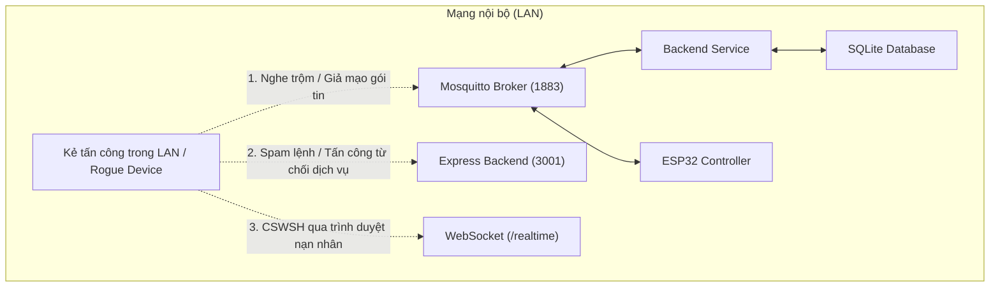

# Tài liệu Bảo mật Hệ thống (Security Architecture & Policy)

Dự án **Smart Irrigation System** là giải pháp IoT giám sát và điều khiển tưới tiêu tự động. Tài liệu này mô tả chi tiết mô hình đe dọa (threat model), các cơ chế bảo mật đã triển khai, danh mục kiểm tra (checklist), các phần ngoài phạm vi (out of scope), cùng khuyến nghị khi triển khai thực tế.

---

## 1. Mô hình đe dọa trong mạng cục bộ (LAN Threat Model)

Hệ thống hoạt động chủ yếu trong mạng nội bộ (LAN gia đình hoặc nông trại). Khi các thiết bị IoT cùng kết nối vào một mạng Wi-Fi/LAN, các nguy cơ bảo mật tiềm ẩn bao gồm:

### Các bề mặt tấn công chính (Attack Surfaces)

1. **Mosquitto MQTT Broker (Cổng 1883)**:
   - **Rủi ro:** Nếu broker cho phép kết nối ẩn danh (`allow_anonymous true`) hoặc lắng nghe trên tất cả các card mạng mà không có mật khẩu, bất kỳ thiết bị lạ nào trong mạng LAN cũng có thể kết nối, đọc lén toàn bộ telemetry (nhiệt độ, độ ẩm) hoặc tiêm (inject) các lệnh điều khiển nguy hiểm như bật bơm liên tục làm úng cây hoặc cháy động cơ bơm.
   - **Nguy cơ nghe trộm:** Giao thức MQTT qua cổng 1883 truyền dữ liệu dưới dạng cleartext trong mạng LAN nếu không có TLS.

2. **REST API Backend (Cổng 3001)**:
   - **Rủi ro:** Tấn công gửi dữ liệu rác, tham số vượt ngưỡng hoặc chuỗi ký tự bất thường vào các API lưu trữ và điều khiển (`POST /commands`, `PUT /config`).
   - **Nguy cơ làm kiệt tài nguyên (DoS):** Gửi liên tiếp hàng ngàn request kích hoạt đóng/ngắt rơ-le phần cứng liên tục (relay chattering) gây hỏng thiết bị vật lý, hoặc spam ghi dữ liệu vào SQLite.
   - **Rò rỉ thông tin (Information Disclosure):** Trả về stack trace chi tiết, câu lệnh SQL lỗi hoặc đường dẫn thư mục máy chủ khi có ngoại lệ.

3. **WebSocket Realtime (`/realtime`)**:
   - **Rủi ro tấn công CSWSH (Cross-Site WebSocket Hijacking):** Nạn nhân mở một trang web độc hại trên cùng mạng LAN. Trang web này chứa script tự động mở WebSocket đến `ws://localhost:3001/realtime` để nghe trộm dữ liệu cảm biến thời gian thực hoặc khai thác phiên làm việc nếu không kiểm tra header `Origin`.

4. **Lưu trữ CSDL & Thông tin bí mật (.env, SQLite)**:
   - **Rủi ro:** Vô tình đưa file cơ sở dữ liệu (`smart-irrigation.db`) chứa dữ liệu lịch sử hoặc file cấu hình `.env` chứa mật khẩu vào kho mã nguồn Git công khai.

---

## 2. Danh mục bảo mật đã triển khai (Implemented Security Checklist)

Hệ thống đã được trang bị các giải pháp bảo vệ tương ứng theo checklist sau:

- [x] **Mosquitto Authentication & Network Isolation**:
  - Tắt hoàn toàn kết nối ẩn danh (`allow_anonymous false`).
  - Sử dụng file mật khẩu được băm an toàn (`password_file mosquitto/password.txt`) với tài khoản riêng biệt cho backend (`garden_backend`) và thiết bị (`esp32_device`).
  - Mặc định ràng buộc (bind) chỉ lắng nghe giao diện nội bộ `127.0.0.1` (`listener 1883 127.0.0.1`), ngăn chặn mọi truy cập trực tiếp từ máy lạ trong LAN khi chưa có nhu cầu.
- [x] **Backend MQTT Credentials**:
  - Hỗ trợ biến môi trường `MQTT_USERNAME` và `MQTT_PASSWORD` trong `.env` và `config.ts`.
  - Kết nối MQTT Gateway tự động gửi credentials khi broker yêu cầu xác thực.
- [x] **Firmware ESP32 Credentials & Fallback**:
  - Firmware ESP32 kết nối với Mosquitto bằng thông tin xác thực (`esp32_device` / mật khẩu).
  - Tích hợp cờ cấu hình `USE_MQTT_AUTH` và ghi chú hướng dẫn: cho phép chuyển sang chế độ anonymous tạm thời khi cần mô phỏng kiểm thử trên Wokwi nếu Wokwi Gateway gặp sự cố mạng ảo.
- [x] **Toàn diện Input Validation API**:
  - `threshold`: Kiểm tra nghiêm ngặt kiểu số nguyên trong phạm vi an toàn `[10, 90]` (từ chối 400 nếu vượt ngưỡng hoặc sai định dạng).
  - `limit`: Kiểm tra kiểu số nguyên dương hợp lệ trong giới hạn cho phép (1 đến 500 với command/changes, 1 đến 10000 với telemetry history).
  - `bucketMs`: Kiểm tra số nguyên dương tối thiểu 1000 ms, chặn số âm và định dạng sai.
  - `from` & `to`: Kiểm tra timestamp hợp lệ, kiểm tra logic `from < to`.
  - `zoneId`: Kiểm tra nằm trong danh mục định danh cho phép (`T001` - `T006`).
  - `commands`: Kiểm tra cấu trúc lệnh, chặn các lệnh điều khiển bơm toàn vườn khi đang ở chế độ tự động (`auto`).
- [x] **Rate Limiting (Giới hạn tần suất)**:
  - Tích hợp middleware Rate Limiting dạng trượt (sliding window) theo IP cho các API can thiệp phần cứng và cấu hình:
    - `POST /api/devices/:deviceId/commands`: Giới hạn tối đa 30 requests / phút / IP.
    - `PUT /api/devices/:deviceId/config/zones/:zoneId`: Giới hạn tối đa 30 requests / phút / IP.
  - Tự động phản hồi HTTP `429 Too Many Requests` kèm các header chuẩn `Retry-After`, `X-RateLimit-*`.
- [x] **Zero Information Disclosure (Chặn rò rỉ Stack Trace / SQL)**:
  - 100% câu truy vấn CSDL SQLite sử dụng Prepared Statements có tham số hóa (`?` hoặc `:param`), loại trừ rủi ro SQL Injection.
  - Middleware xử lý lỗi toàn cục Express 5 bắt mọi ngoại lệ và chỉ trả về mã lỗi JSON chuẩn (`Invalid request format or JSON body` hoặc `Internal server error`), tuyệt đối không gửi stack trace hay lỗi SQLite ra ngoài client.
- [x] **CORS & Security Headers**:
  - CORS giới hạn chính xác theo domain được cấu hình trong `WEB_ORIGIN`.
  - Bổ sung các HTTP Security Headers tiêu chuẩn:
    - `X-Content-Type-Options: nosniff` (chống đoán sai kiểu MIME).
    - `X-Frame-Options: DENY` (chống Clickjacking).
    - `Referrer-Policy: no-referrer`.
    - `Permissions-Policy: camera=(), microphone=(), geolocation=()`.
    - `Content-Security-Policy: default-src 'none'; frame-ancestors 'none'`.
- [x] **Chống CSWSH trên WebSocket**:
  - WebSocket Server tích hợp bộ kiểm tra `verifyClient`.
  - Kiểm tra và chỉ chấp nhận kết nối có header `Origin` khớp với `WEB_ORIGIN` (cho phép các client native/script không mang header Origin). Từ chối kết nối lạ bằng mã HTTP 403 Forbidden.
- [x] **Chính sách Git & Quản lý file nhạy cảm (.gitignore)**:
  - Bổ sung `.gitignore` cấp cao nhất của dự án và các thư mục con.
  - Chặn triệt để: `.env`, `.env.*.local`, `data/*.db`, `*.db-journal`, `*.db-wal`, `mosquitto/password.txt`, build outputs (`dist/`, `.next/`), logs.

---

## 3. Các mục nằm ngoài phạm vi (Out of Scope)

Dự án hiện tại là hệ thống quản lý tưới tiêu chuyên dụng cho hộ gia đình/mô hình nông nghiệp nhỏ. Các tính năng sau được xác định **nằm ngoài phạm vi của phiên bản này**:

1. **Hệ thống Đăng nhập & Quản lý tài khoản người dùng (User Authentication / Login)**:
   - Dự án chưa tích hợp màn hình đăng nhập, tài khoản người dùng, hay hệ thống cấp phát token (JWT, Session Cookie, OAuth2).
   - Mọi người dùng có quyền truy cập vào Web Dashboard trên mạng nội bộ đều có thể tương tác với giao diện điều khiển.

2. **Phân quyền người dùng (Role-Based Access Control - RBAC)**:
   - Không phân chia vai trò (như Super Admin, Kỹ thuật viên, Người xem chỉ đọc - Viewer).
   - Mọi kết nối hợp lệ vào API đều có thẩm quyền như nhau trong việc gửi lệnh và chỉnh ngưỡng.

---

## 4. Khuyến nghị nâng cấp khi triển khai môi trường thực tế (Future Roadmap)

Khi đưa hệ thống vào vận hành thực tế quy mô lớn hoặc kết nối từ xa qua Internet, nhóm phát triển nên thực hiện các nâng cấp sau:

1. **Mã hóa đường truyền (HTTPS & MQTTS)**:
   - Đặt backend đằng sau một Reverse Proxy như **Nginx**, **Caddy** hoặc **Traefik** để tự động quản lý chứng chỉ HTTPS/TLS.
   - Cấu hình Mosquitto chạy cổng 8883 với chứng chỉ TLS để mã hóa toàn bộ dữ liệu telemetry và lệnh điều khiển trên đường truyền không dây.

2. **Thêm lớp xác thực ứng dụng (API Authentication)**:
   - Bổ sung xác thực Bearer Token (JWT) hoặc API Key cho các endpoint điều khiển (`/commands`, `/config`).
   - Tích hợp giao diện đăng nhập cho Web Dashboard và Mobile App.

3. **Bảo mật phần cứng ESP32**:
   - Sử dụng NVS Encryption để bảo vệ thông tin mật khẩu Wi-Fi và MQTT lưu trên chip.
   - Bật Secure Boot và Flash Encryption trên ESP32 để chống sao chép trái phép firmware.

4. **Phân vùng mạng (VLAN & Firewall)**:
   - Đưa các thiết bị IoT vào một VLAN riêng biệt (IoT VLAN), cách ly với mạng máy tính cá nhân và các thiết bị giải trí khác trong gia đình.

